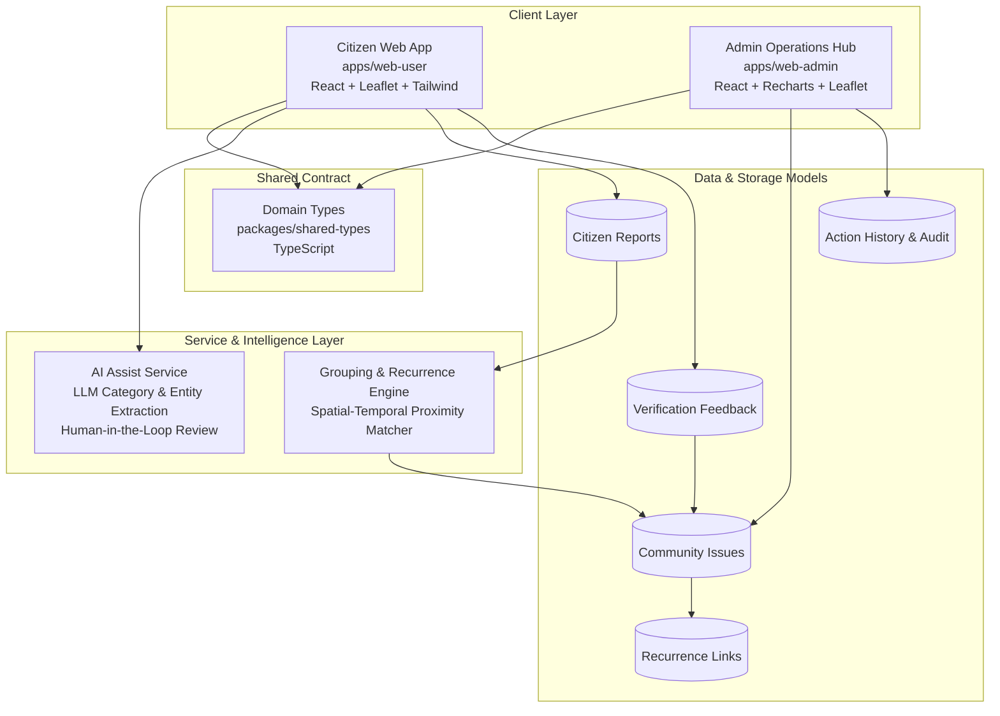
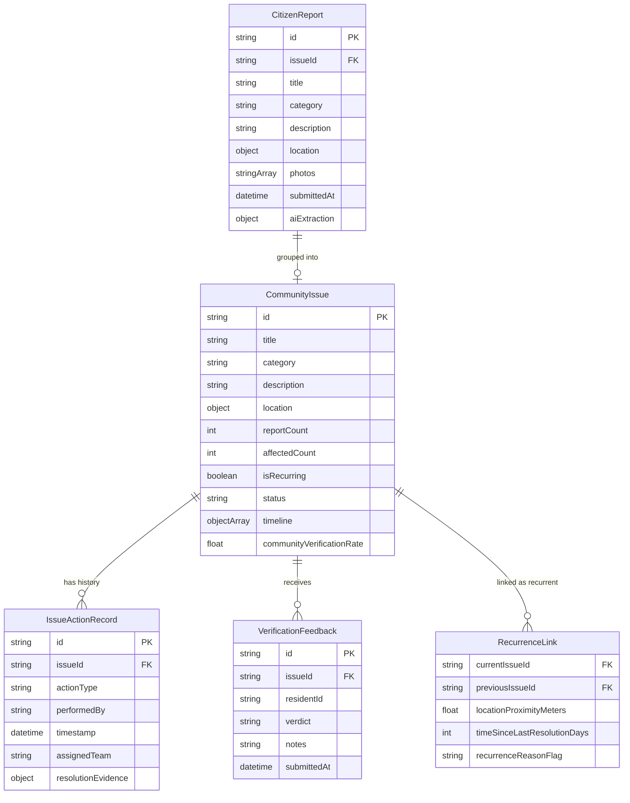

# CivicPulse

> **One Door for Every Civic Issue** — Community Intelligence, Recurring-Issue Detection, and Verifiable Resolution.

CivicPulse is a community-driven civic issue intelligence platform designed for hackathon demonstration. It bridges the gap between local residents and municipal councils (such as Majlis Bandaraya Petaling Jaya / MBPJ) by addressing fragmented reporting, identifying repeat infrastructure failures, and creating a transparent verification loop when repairs are completed.

---

## 1. Problem Statement

Across Malaysian municipal councils and urban neighborhoods, municipal maintenance faces three systemic friction points:

1. **Fragmented & Duplicate Reporting**: When a major hazard occurs (such as an overflowing drain or a cratering pothole), dozens of residents file isolated complaints across disconnected channels (WhatsApp, hotlines, social media). Authorities are flooded with redundant tickets with no unified view of how many citizens are impacted.
2. **Invisible Recurring Failures**: Potholes get patched only to wash away during the next monsoon downpour. Without spatial-temporal tracking, councils treat repeat occurrences as isolated events rather than symptoms of contractor quality issues or underlying drainage failures.
3. **The "Black Hole" & Premature Closure**: Work orders are frequently marked "Resolved" by contractors with minimal accountability. Citizens have no visibility into the corrective action taken, nor a mechanism to contest incomplete repairs before cases are permanently closed.

---

## 2. Core Value Proposition

CivicPulse is **not** another generic municipal complaint form. Its key differentiators are:
* **Community Intelligence**: Separates individual reports from community-level issues, aggregating collective impact (*"I'm Affected Too"*) to give authorities a clear picture of localized priority.
* **Recurring Issue Detection**: Flags problems that reappear at or near the same location after previous closure, preserving historical incident context for root-cause investigation.
* **Verifiable Resolution Loop**: Closes the loop by presenting proof of work (such as before-and-after photos) and enabling residents to audit and verify whether the issue was genuinely fixed.

---

## 3. Core Features (MVP Scope)

### 3.1 Community Issue Map
* **Interactive Map**: Displays active and historical community issues pinned across the municipal area using interactive OpenStreetMap / Leaflet tiles.
* **Intensity & Density Zones**: Highlights clusters of reports. *Map intensity reflects the concentration of distinct reports and affected residents in a zone*, not arbitrary algorithmic panic scores.
* **Multi-Dimensional Filters**: Filter issues by category (Roads, Drainage, Waste, Lighting, Hazard, etc.), status, and **recurring issue flags**.

### 3.2 Community Reporting & "I'm Affected Too"
* **Low-Friction Reporting**: Residents submit an incident with description, category, street location / map pin, and photo evidence.
* **Impact Endorsement ("I'm Affected Too")**:
  - Nearby residents can tap **"I'm Affected Too"** on an existing issue instead of creating duplicate tickets.
  - **Clean Metric Separation**: The system explicitly displays **Report Count** (number of separate submissions) alongside **Affected Resident Count** (number of impacted people).
  - *Guardrail*: Community endorsements reflect human impact and help prioritize triage, but do not automatically override municipal emergency severity assessments.

### 3.3 AI-Assisted Report Processing
* **LLM Information Extraction**: Assists residents during report creation by extracting suggested categories, structured descriptions, and location landmarks from unstructured text (e.g., *"longkang tersumbat dekat SS2 pasar pagi"* ➔ Category: `DRAINAGE`, Landmark: `SS2 Morning Market`).
* **Human-in-the-Loop Corrections**: AI suggestions are presented as editable recommendations. Both the reporting citizen and council admins can review and adjust any categorization or location details.
* *Realistic Limitation*: AI assists with triage and tagging; it does not claim to guess exact GPS coordinates without user confirmation, nor does it definitively diagnose subterranean root causes.

### 3.4 Related Report Grouping
* **Incident Clustering Suggestions**: Groups related individual submissions based on spatial proximity, category match, and time-window correlation.
* **Admin Review Queue**: AI / rule-based suggestions propose linking reports to an existing Community Issue, but administrators retain full review to accept or unlink reports, preventing erroneous automated merges.

### 3.5 Recurring Issue Detection
* **Spatial & Historical Proximity Matching**: When a new incident is submitted within close proximity of a previously resolved issue in the same category, the system flags it as a **Potential Recurrence**.
* **Distinguishable History**: Active issues and past closed records are kept distinct, while linking to previous case files so inspectors can see past contractor interventions and recurring failure patterns.

### 3.6 Resolution Tracking & Verification
* **Issue Timeline & Proof of Work**: Records status transitions from `REPORTED` ➔ `VERIFIED` ➔ `IN_PROGRESS` ➔ `MARKED_RESOLVED` ➔ `COMMUNITY_VERIFIED`. Contractors/admins upload corrective action notes and after-photos.
* **Community Verification Audit**:
  - Once marked resolved, affected residents are prompted to confirm: **Fixed**, **Partially Fixed**, or **Not Fixed**.
  - **Dispute Safeguard**: If community feedback is predominantly negative, the issue transitions to `DISPUTED` for administrative investigation. To prevent malicious gaming, individual single votes do not unilaterally overturn case statuses.

### 3.7 Municipal Operations Dashboard (Prototype)
* **Administrative Triage Hub**: Municipal officers can view aggregated incidents, monitor SLA targets, review related reports, and log internal updates.
* **Team Assignment & Action Logging**: Simulates assigning lead response teams or contractors (e.g., MBPJ Engineering, Alam Flora) and records the audit history.
* **Recurrence & Hotspot Monitoring**: Highlights neighborhoods with repeat infrastructure breakdowns for proactive capital budgeting.

---

## 4. System Architecture & Tech Stack



### Technology Stack
* **Architecture**: Monorepo managed via npm workspaces.
* **Frontend Apps**:
  - `apps/web-user`: Mobile-responsive citizen reporting and verification portal (React, Vite, Leaflet, Lucide icons).
  - `apps/web-admin`: Municipal command dashboard with data visualization (React, Vite, Recharts, Leaflet, Tailwind CSS).
* **Shared Types**: `packages/shared-types` containing domain definitions shared across apps.
* **Styling**: Tailwind CSS with custom glassmorphism components and mobile-first responsive layout.

---

## 5. Domain Data Model

The data model enforces strict separation of concerns across 5 core entities:



### Entity Responsibilities:
1. **`CitizenReport`**: Represents an individual resident's raw submission (description, uploaded photo, GPS point, AI parsing suggestions).
2. **`CommunityIssue`**: The grouped canonical issue representing the underlying physical defect in the neighborhood. Aggregates `reportCount` and `affectedCount`.
3. **`IssueActionRecord`**: Immutable log of municipal actions (status change, team assignment, corrective actions taken, and after-photos).
4. **`VerificationFeedback`**: Resident votes (`FIXED`, `PARTIAL`, `NOT_FIXED`) and verification evidence for a completed repair.
5. **`RecurrenceLink`**: Explicit relational link between a new community issue and past closed issues at the same location.

---

## 6. End-to-End Workflow

```
[1. Resident Submits Report]
        │
        ▼
[2. AI Extraction Assistance] ──► Resident confirms/edits category & location clues
        │
        ▼
[3. Proximity & Recurrence Check]
   ├── Nearby active issue found? ──► Suggest merging / endorse "I'm Affected Too"
   └── Past resolved issue nearby? ──► Flag as Potential Recurrence
        │
        ▼
[4. Municipal Operations Review] ──► Officer reviews ticket, validates status, assigns team
        │
        ▼
[5. Corrective Action Taken] ──► Contractor submits repair details & after-photo evidence
        │
        ▼
[6. Status: MARKED_RESOLVED]
        │
        ▼
[7. Community Verification Loop]
   ├── High Approval (≥70%) ──► Status: COMMUNITY_VERIFIED (Closed)
   └── Substantial Contestation ──► Status: DISPUTED (Escalated for re-inspection)
```

---

## 7. Realistic Hackathon Prototype Boundaries

To maintain a grounded, achievable scope for a student hackathon:

| Feature Area | Prototype Implementation (In Scope) | Production Real-World Requirement (Out of Scope / Future) |
|---|---|---|
| **Council Dispatch** | In-app team assignment dropdown and simulated dispatch confirmation. | Direct API integration with municipal enterprise resource planning (ERP) or fleet GPS systems. |
| **SLA Tracking** | Internal configurable target timers based on priority level. | Binding statutory government response-time contracts. |
| **Social Media Signals** | Standalone sandbox demonstration showcasing AI-assisted triage of social complaint samples. | 24/7 firehose streaming and live Twitter/Facebook developer API scraping. |
| **AI Assist** | Prompt-engineered LLM extraction for category, entity, and summary recommendations with human editability. | Fully autonomous decisions or automated root-cause engineering diagnosis. |
| **Identity & Authentication** | Mock National ID / Admin Badge authentication. | MyDigital ID / official government SSO integration. |

---

## 8. Getting Started

### Prerequisites
* Node.js (v18 or higher recommended)
* npm (v9 or higher)

### Installation
Clone the repository and install dependencies at the root:
```bash
git clone https://github.com/chariyanai8-svg/civicpulse.git
cd civicpulse
npm install
```

### Running Locally
Run both the citizen app and the admin operations hub concurrently:
```bash
npm run dev
```

Or run each application individually:
* **Citizen App** (`http://localhost:3000`):
  ```bash
  npm run dev:user
  ```
* **Admin Operations Hub** (`http://localhost:3001`):
  ```bash
  npm run dev:admin
  ```

### Building for Production
```bash
npm run build --workspaces
```

---

## 9. License & Disclaimer
This project is developed for educational and hackathon demonstration purposes. Government agency names (e.g., MBPJ, DBKL, JKR) and public defect scenarios are used as representative Malaysian civic context.
