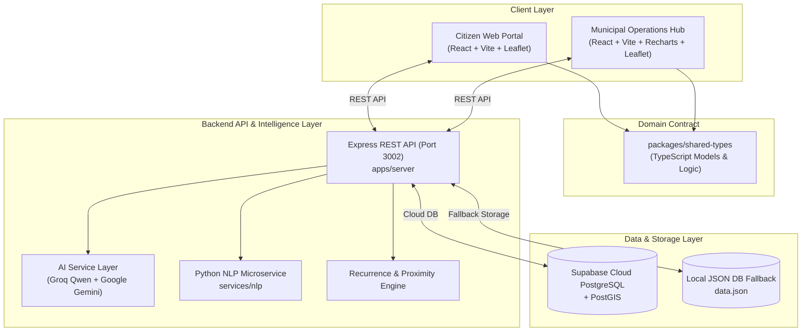

# CivicPulse 🏙️⚡

> **One Door for Every Civic Issue** — Community Intelligence, Recurring-Issue Detection, and Verifiable Resolution.

CivicPulse is a smart civic intelligence platform engineered to bridge the gap between urban citizens and municipal councils (such as Majlis Bandaraya Petaling Jaya / MBPJ & DBKL). 

Rather than functioning as a standard one-way complaint ticketing form, CivicPulse uses **geospatial clustering**, **dual-engine AI assistance (Groq & Google Gemini)**, **spatial-temporal recurrence detection**, and a **closed-loop community verification audit** to eliminate duplicate complaints, detect chronic infrastructure failures, and hold contractors accountable.

---

## 📑 Table of Contents
- [The Problem](#-the-problem)
- [Key Features](#-key-features)
- [System Architecture](#-system-architecture)
- [Tech Stack](#-tech-stack)
- [Monorepo Structure](#-monorepo-structure)
- [Getting Started](#-getting-started)
- [Environment Variables](#-environment-variables)
- [API Endpoints](#-api-endpoints)
- [Domain Model & Data Architecture](#-domain-model--data-architecture)

---

## 🚨 The Problem

Across Malaysian municipal councils and urban townships, civic maintenance faces three systemic friction points:

1. **Fragmented & Redundant Complaints**: When an incident occurs (e.g. an overflowing monsoon drain or road cave-in), dozens of residents file isolated reports across disconnected channels (WhatsApp, hotlines, social media). Councils are flooded with duplicate tickets and have no unified view of collective citizen impact.
2. **Invisible Recurring Failures**: Potholes get patched only to wash away during the next heavy rain. Without spatial-temporal tracking, councils treat repeat occurrences as isolated events rather than symptoms of contractor quality flaws or root drainage failures.
3. **The "Black Hole" & Premature Closure**: Work orders get marked "Resolved" by contractors with zero transparency. Citizens have no visibility into the corrective action taken, nor a mechanism to audit and confirm the repair before the ticket is closed.

---

## 🌟 Key Features

### 1. Citizen Web Application (`apps/web-user`)
* **Interactive Live Map**: Pinned community issues with color-coded categories, severity indicators, and recurrence badges on OpenStreetMap tiles.
* **AI-Assisted Incident Reporting**:
  * Bilingual Natural Language Processing (English & Bahasa Melayu).
  * Automatically suggests categories (e.g., `ROADS`, `DRAINAGE`, `LIGHTING`), severity, and landmark clues (e.g., *"longkang tersumbat dekat SS2 pasar pagi"* ➔ `DRAINAGE` @ SS2 Morning Market).
  * Human-in-the-loop review: Citizens can review and edit all AI suggestions before submitting.
* **"I'm Affected Too" Endorsement**:
  * Instead of filing duplicate tickets, nearby residents can endorse an existing issue with a single click.
  * Explicit separation between **Report Count** (submissions) and **Affected Resident Count** (human impact).
* **Community Verification Loop**:
  * Once a contractor marks an issue as resolved, affected residents are prompted to audit the work: **Fixed**, **Partially Fixed**, or **Not Fixed**.
  * Prevents premature closure and escalates disputed repairs back to the council.
* **Bilingual AI Civic Assistant**:
  * 24/7 contextual chatbot supporting English and Bahasa Melayu to assist with issue status, council jurisdictions, and municipal guidelines.

### 2. Municipal Operations Hub (`apps/web-admin`)
* **Administrative Triage Hub & Kanban View**: Filter by status, severity, recurring flags, and municipal zones.
* **Spatial-Temporal Recurring Issue Engine**:
  * Proximity algorithms detect incidents occurring within 50 meters and 90 days of a previously resolved issue.
  * Preserves historical case files to identify chronic failure patterns and contractor quality issues.
* **Team Assignment & Dispatch**: Dispatch council units or contractors (e.g., MBPJ Kejuruteraan, Alam Flora, TNB, JKR) and record status transitions.
* **Resolution Evidence Upload**: Attach corrective action logs and before-and-after photos.
* **Social Media Signal Validation**: Ingests and triages social chatter (e.g., Twitter/X complaints) and matches them to active municipal issues.
* **Analytics & Capital Planning**: Visualizes recurring failure hotspots, contractor resolution rates, and SLA compliance.

---

## 🏗️ System Architecture



---

## 🛠️ Tech Stack

| Layer | Technologies |
|---|---|
| **Monorepo** | npm Workspaces |
| **Frontend Clients** | React 18, Vite, TypeScript, Tailwind CSS |
| **Data Visualization & GIS** | Leaflet, React-Leaflet, OpenStreetMap, Recharts, Lucide Icons |
| **Backend API** | Node.js, Express, TypeScript, `tsx` |
| **AI & LLM Services** | Groq SDK (`qwen/qwen-2.5-32b`), Google Generative AI (`gemini-1.5-flash`), Local Regex Heuristics fallback |
| **NLP Microservice** | Python 3.10+, FastAPI, Hugging Face Transformers, PyTorch |
| **Database & Storage** | Supabase Cloud (PostgreSQL) + Local JSON-backed resilience cache |

---

## 📁 Monorepo Structure

```text
civicpulse/
├── apps/
│   ├── server/             # Express.js REST API & AI Service layer
│   │   ├── src/
│   │   │   ├── index.ts    # Main API server routes & controllers
│   │   │   ├── aiService.ts# Groq & Gemini hybrid orchestration
│   │   │   ├── nlp.ts      # Text analysis & keyword triage engine
│   │   │   └── supabase.ts # Supabase PostgreSQL client & seed logic
│   │   └── data.json       # Local prototype database state
│   ├── web-admin/          # Municipal command center & analytics dashboard
│   │   └── src/
│   │       ├── components/ # LiveMap, Dashboard, AllIssues, SignalValidation, CivicChatbot
│   │       └── mockData.ts # Initial UI datasets
│   └── web-user/           # Citizen mobile-first reporting & verification portal
├── packages/
│   └── shared-types/       # Canonical TypeScript domain interfaces and utility functions
├── services/
│   └── nlp/                # FastAPI Python service for advanced text classification & NER
├── package.json            # Root workspace configuration
└── README.md
```

---

## 🚀 Getting Started

### Prerequisites
* **Node.js**: v18.0.0 or higher
* **npm**: v9.0.0 or higher
* (Optional) **Python 3.10+**: If running the standalone NLP service

### 1. Installation
Clone the repository and install dependencies at the monorepo root:
```bash
git clone https://github.com/chariyanai8-svg/civicpulse.git
cd civicpulse
npm install
```

### 2. Configure Environment Variables
Create a `.env` file in the root directory (or in `apps/server/.env`):
```env
PORT=3002

# Supabase Database (Optional - falls back to local data.json if not provided)
SUPABASE_URL=https://your-project.supabase.co
SUPABASE_KEY=your-supabase-anon-or-service-role-key

# AI Services (Optional - falls back to local NLP engine if not provided)
GROQ_API_KEY=gsk_your_groq_api_key_here
GEMINI_API_KEY=your_gemini_api_key_here
```

### 3. Run the Development Environment

Run both the **Backend Server** and the **Frontend Admin Portal** concurrently:
```bash
npm run dev
```

Or run applications individually:
* **Backend Server** (`http://localhost:3002`):
  ```bash
  npm run dev:server
  ```
* **Admin Operations Hub** (`http://localhost:3000`):
  ```bash
  npm run dev:admin
  ```
* **Citizen Web Portal**:
  ```bash
  npm run dev:user
  ```

---

## 📡 Key API Endpoints

| Method | Endpoint | Description |
|---|---|---|
| `GET` | `/api/issues` | Retrieve all community issues (supports `?category=`, `?status=`, `?search=`) |
| `POST` | `/api/reports` | Submit a new citizen report (triggers recurrence checks) |
| `POST` | `/api/issues/:id/endorse` | Register "I'm Affected Too" impact endorsement |
| `POST` | `/api/issues/:id/verify` | Submit citizen verification feedback (`FIXED`, `PARTIAL`, `NOT_FIXED`) |
| `POST` | `/api/ai/chat` | Send queries to the bilingual AI Civic Assistant |
| `POST` | `/api/ai/analyze-report` | AI extraction for category, severity, and landmark hints |
| `GET` | `/api/signals` | Fetch social media / external complaints queue |
| `POST` | `/api/signals/triage` | Batch analyze and triage social media signals |

---

## 📊 Domain Model & Data Architecture

The platform separates raw citizen complaints from canonical community issues:

1. **`CitizenReport`**: An individual resident's raw submission (description, uploaded photo, GPS point, AI extracted tags).
2. **`CommunityIssue`**: The grouped canonical issue representing the underlying physical defect in the neighborhood. Aggregates `reportCount` and `affectedCount`.
3. **`IssueActionRecord`**: Immutable audit log of municipal actions (status change, team assignment, corrective actions taken, after-photos).
4. **`VerificationFeedback`**: Resident audit votes (`FIXED`, `PARTIAL`, `NOT_FIXED`) and verification evidence for a completed repair.
5. **`RecurrenceLink`**: Explicit relational link between a new community issue and past closed issues at the same location.

---

## 👥 Authors & Acknowledgments
Developed for hackathon demonstration with focus on Malaysian municipal modernization (MBPJ / DBKL context).
